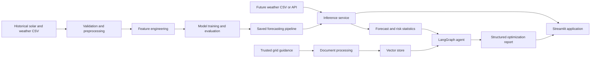
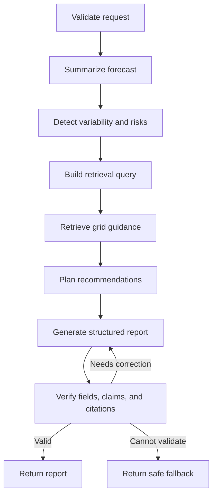

# Intelligent Solar Energy Forecasting and Agentic Grid Optimization

## 1. Document purpose

This document converts the original project brief in `Project 13_AI_ML.pdf` into a practical build plan for **one developer**. This is a single continuous project, not a mid-semester/end-semester submission. The stages below only describe the recommended implementation order.

The project will first build a reliable solar-generation forecasting system and then use that forecast in an agentic, retrieval-augmented assistant that recommends grid-balancing, storage, and energy-utilization actions.

---

## 2. Project context

### 2.1 Background

Solar generation changes with irradiance, temperature, cloud cover, season, and time of day. This variability makes it difficult to plan when energy should be consumed, stored, curtailed, or supplemented from another source. Historical generation and weather data can be used to forecast future output, but a forecast alone does not explain the operational risks or the actions that should follow.

This project combines:

1. A machine-learning forecasting pipeline for predicting solar-energy generation.
2. A visual web application for exploring data, forecasts, trends, and model quality.
3. A LangGraph-based assistant that analyzes forecast variability.
4. A retrieval-augmented generation (RAG) system grounded in trusted grid-management guidance.
5. A structured advisory report containing risks, recommended actions, optimization ideas, and supporting references.

### 2.2 Problem statement

Build a publicly accessible application that predicts solar-energy generation from historical generation and weather data and then turns the forecast into grounded, understandable, and actionable grid-management recommendations.

### 2.3 Primary goal

Create an end-to-end application that can:

- Load and validate solar-generation and weather data.
- Clean the data and engineer useful temporal and weather features.
- Train and evaluate regression/time-series forecasting models.
- Generate future solar-production forecasts.
- Visualize forecast values, trends, errors, and risk periods.
- Retrieve relevant guidance from a curated knowledge base.
- Use an explicit LangGraph workflow to produce structured recommendations.
- Cite the sources used for recommendations.
- Run on a public free-tier hosting platform.

### 2.4 Intended users

- Microgrid or facility managers planning generation, loads, and storage.
- Solar-plant operators and analysts who need site-level generation visibility.
- Energy analysts studying renewable-generation variability.
- Students and developers learning applied forecasting and agentic AI.

The MVP uses one aggregated microgrid/solar-site generation signal. Individual household and rooftop-solar forecasting is deferred because mixed roof directions, tilt angles, shading, capacities, and inverter configurations require a separate residential modeling strategy.

The first release is an **advisory and educational tool**. It will not directly control batteries, inverters, grid switches, or other physical equipment.

### 2.5 Core user journey

1. The user opens the deployed web application.
2. The user selects bundled demonstration data or uploads compatible CSV data.
3. The application validates the columns, timestamps, units, and missing values.
4. The user selects a forecast horizon and starts forecasting.
5. The application displays predicted generation, trends, model metrics, and uncertainty where available.
6. The user requests a grid-optimization report.
7. The agent analyzes forecast variability and identifies risk periods.
8. The RAG component retrieves relevant passages from trusted guidance.
9. The agent returns structured actions, storage recommendations, utilization strategies, caveats, and citations.
10. The user downloads the forecast and optimization report.

### 2.6 Initial forecasting contract

The recommended minimum viable product (MVP) is an **hourly, day-ahead forecast** containing the next 24 hourly values. The implementation should keep the horizon configurable so it can later support shorter or longer forecasts.

The first model should forecast one aggregate generation meter for one microgrid or solar plant. Prefer a site with a homogeneous fixed-tilt array and one representative orientation. If reliable orientation metadata is unavailable, begin with site-level irradiance, weather, temporal, and generation-history features; do not model separate array blocks or mixed orientations in the MVP.

Future predictions require weather values for the forecast period. The first version can accept a future-weather CSV. A live weather API can be added later after the offline pipeline is reliable.

#### Historical training data

Required logical fields:

| Field | Purpose |
|---|---|
| `timestamp` | Date and time of the observation |
| `power_generation` | Forecast target, in a documented unit such as kW or MW |
| `irradiance` | Solar irradiance measurement |
| `temperature` | Ambient or panel temperature, clearly documented |
| `cloud_cover` | Cloud-cover value with a documented scale |

Useful optional fields include humidity, wind speed, precipitation, panel temperature, rated DC/AC plant capacity, latitude, longitude, site elevation, representative tilt/azimuth, plant status, curtailment flags, and weather condition.

#### Future forecast input

Required logical fields:

- `timestamp`
- `irradiance`
- `temperature`
- `cloud_cover`

If lag-based features are used, the inference pipeline must also receive enough recent generation history to construct them safely.

#### Forecast output

- Timestamp.
- Predicted solar generation.
- Forecast horizon.
- Prediction interval or confidence band when supported.
- Summary statistics such as expected total energy, peak generation, peak time, and low-generation periods.

#### Agent output

- Forecast summary.
- Variability and risk periods.
- Grid-balancing recommendations.
- Battery/storage recommendations.
- Energy-utilization strategies.
- Assumptions and limitations.
- Supporting source references.

### 2.7 Scope

#### Included in the first complete release

- CSV ingestion and schema validation.
- Reproducible data preprocessing.
- Temporal, weather, lag, and rolling features where valid.
- Chronological train/validation/test splitting.
- Baseline and multiple candidate forecasting models.
- MAE and RMSE evaluation, including daylight-period evaluation.
- Saved model and preprocessing artifacts.
- Streamlit user interface.
- Forecast visualization and CSV export.
- Curated grid-guidance knowledge base.
- Chroma or FAISS vector retrieval.
- LangGraph workflow with explicit state.
- Structured, cited recommendations.
- Public deployment and project documentation.
- One aggregate microgrid or solar-plant generation site for the initial model.

#### Outside the first release

- Direct control of real grid hardware.
- Automated electricity trading.
- Safety-critical decisions without human review.
- Guaranteed forecasts for every geography or plant type.
- Paid data, model, or hosting services.
- Large-scale real-time telemetry ingestion.
- Native mobile applications.
- Individual household and rooftop-solar personalization.
- Mixed roof directions, separate array blocks, and multi-orientation modeling.
- Tracker-specific or block-level plant models unless the selected MVP dataset requires them.

### 2.8 Recommended technology stack

| Area | Recommended choice |
|---|---|
| Language | Python 3.11 or another hosting-supported stable version |
| Data processing | pandas, NumPy |
| Machine learning | scikit-learn pipelines and regression models |
| Visualization | Plotly and Streamlit charts |
| Web UI | Streamlit |
| Model persistence | joblib |
| Agent workflow | LangGraph |
| Structured schemas | Pydantic or typed dictionaries |
| RAG store | Chroma or FAISS |
| Embeddings | A small open-source sentence-transformer or a free-tier embedding API |
| LLM | Open-source model or free-tier API selected at implementation time |
| Testing | pytest |
| Code quality | Ruff and, optionally, Black/mypy |
| Hosting | Streamlit Community Cloud, Hugging Face Spaces, or Render free tier |

All provider-specific code should be behind a small adapter so the LLM or embedding provider can be changed without rewriting the workflow.

### 2.9 High-level architecture



### 2.10 Proposed LangGraph workflow



### 2.11 Non-functional requirements

- **Reproducibility:** training should be repeatable with fixed seeds and versioned configuration.
- **No leakage:** future target values must never enter training features or fitted preprocessing steps.
- **Usability:** validation errors must tell the user exactly how to fix the input.
- **Traceability:** forecasts must identify the model version; advice must include references.
- **Reliability:** the application must handle empty, malformed, and partially missing data safely.
- **Performance:** the hosted app should load quickly enough for an interactive demonstration on free-tier resources.
- **Security:** secrets must be stored in environment variables or the hosting platform's secret manager.
- **Responsible AI:** recommendations must be advisory, grounded, uncertainty-aware, and subject to human review.
- **Maintainability:** data, forecasting, retrieval, agent, and UI logic should live in separate modules.

### 2.12 Definition of project completion

The project is complete when:

- A new user can access the public application without running it locally.
- Bundled sample data produces a complete forecast without errors.
- Valid uploaded data can be checked and forecast successfully.
- Model metrics are reported against simple baselines on an untouched chronological test set.
- The agent returns all required report sections in a validated structure.
- Every retrieved recommendation includes a usable source reference.
- The application degrades safely if the LLM or retrieval service is unavailable.
- Automated tests pass in a clean environment.
- The repository contains setup, architecture, data, model, agent, deployment, and usage documentation.
- A short demonstration video shows the complete user journey.

---

## 3. Recommended repository structure

```text
Solar_forecast/
├── app.py
├── README.md
├── PROJECT_CONTEXT_AND_TASKS.md
├── requirements.txt
├── .env.example
├── .gitignore
├── config/
│   ├── data.yaml
│   ├── model.yaml
│   └── agent.yaml
├── data/
│   ├── raw/
│   ├── interim/
│   ├── processed/
│   ├── sample/
│   └── knowledge_base/
├── artifacts/
│   ├── models/
│   ├── metrics/
│   └── vector_store/
├── notebooks/
│   └── 01_exploration.ipynb
├── scripts/
│   ├── prepare_data.py
│   ├── train.py
│   ├── evaluate.py
│   └── build_vector_store.py
├── src/
│   ├── data/
│   ├── features/
│   ├── models/
│   ├── forecasting/
│   ├── retrieval/
│   ├── agent/
│   └── ui/
├── tests/
├── docs/
└── .github/workflows/
```

Generated data and large model artifacts should not be committed unless their size and license make that appropriate. Include scripts and instructions that reproduce them.

---

## 4. Ordered implementation plan

Complete the following tasks in order. Each task is divided into small, checkable actions. Later tasks may be refined when the selected dataset and deployment platform are known.

### Stage 1 — Fix the product definition

#### Task 1 — Record the project decisions

- [x] Confirm that this is owned and implemented by one developer.
- [x] Record that there are no semester-based submissions or team assignments.
- [ ] Use this roadmap as a living document and update decisions when they change.
- [ ] Add a small decision log with date, decision, reason, and consequence.

#### Task 2 — Define the first user and use case

- [x] Set microgrid operators and solar-plant analysts as the initial users.
- [x] Defer individual household and rooftop-solar users.
- [ ] Write one sentence describing the user's main problem.
- [ ] Write the exact result the user should obtain from the application.

#### Task 3 — Finalize the forecast horizon

- [ ] Adopt hourly day-ahead forecasting as the initial target.
- [ ] Define the default horizon as 24 timestamps.
- [ ] Decide whether users can choose another horizon in the first release.
- [ ] Document how future weather values will be supplied for every forecast timestamp.

#### Task 4 — Finalize units and terminology

- [ ] Choose and document the power unit, such as kW or MW.
- [ ] Distinguish instantaneous power from interval energy, such as kWh.
- [ ] Document irradiance, temperature, and cloud-cover units.
- [ ] Define the timezone policy and daylight-saving-time behavior.

#### Task 5 — Define measurable acceptance criteria

- [ ] Require improvement over at least one naive baseline.
- [ ] Require MAE and RMSE on an untouched chronological test period.
- [ ] Require both overall and daylight-only metrics.
- [ ] Require a valid structured agent response with citations.
- [ ] Require a publicly accessible final application.

#### Task 6 — Create the initial risk register

- [ ] Record the risk of not finding compatible generation and weather data.
- [ ] Record the risk of leakage from lag and rolling features.
- [ ] Record free-tier memory, latency, quota, and cold-start risks.
- [ ] Record hallucination and unsupported-recommendation risks.
- [ ] Add one prevention or fallback action for every risk.

### Stage 2 — Bootstrap the project

#### Task 7 — Initialize source control

- [ ] Initialize a Git repository.
- [ ] Create a clear initial commit.
- [ ] Add a Python-focused `.gitignore`.
- [ ] Ignore environment files, caches, generated artifacts, and local vector databases as appropriate.

#### Task 8 — Create the folder structure

- [ ] Create the directories shown in the recommended structure.
- [ ] Add placeholder files only where Git would otherwise omit an empty required directory.
- [ ] Keep raw, processed, sample, and knowledge-base data separate.
- [ ] Keep reusable source code out of notebooks.

#### Task 9 — Create the Python environment

- [ ] Select the Python version supported by the intended host.
- [ ] Create and activate a virtual environment.
- [ ] Upgrade the package installer.
- [ ] Record the setup commands in the README.

#### Task 10 — Install the minimum development dependencies

- [ ] Install pandas, NumPy, scikit-learn, joblib, Streamlit, and Plotly.
- [ ] Install pytest and Ruff.
- [ ] Install LangGraph, the selected LLM integration, and Chroma or FAISS.
- [ ] Install only one initial embedding solution to limit dependency size.
- [ ] Export reproducible dependency versions.

#### Task 11 — Add configuration management

- [ ] Create separate data, model, and agent configuration files.
- [ ] Store column mappings, units, paths, random seeds, and thresholds in configuration.
- [ ] Add a typed configuration loader.
- [ ] Fail with a clear message when required configuration is absent or invalid.

#### Task 12 — Add basic engineering safeguards

- [ ] Configure Ruff formatting and linting rules.
- [ ] Add a basic pytest configuration.
- [ ] Add application logging without secrets or uploaded-data contents.
- [ ] Create `.env.example` using placeholder values only.
- [ ] Add a simple continuous-integration workflow for linting and tests.

### Stage 3 — Acquire and understand the data

#### Task 13 — Find candidate datasets

- [ ] Search for datasets containing timestamped solar generation and weather observations.
- [ ] Prefer a dataset with at least several months and ideally one full year.
- [ ] Check timestamp frequency, location, plant capacity, and missing periods.
- [ ] Compare at least two candidates before choosing one.

#### Task 14 — Check data rights and provenance

- [ ] Record the dataset publisher and original URL.
- [ ] Record the license and allowed redistribution terms.
- [ ] Record when and how the data was downloaded.
- [ ] Avoid committing data that the license does not allow redistributing.

#### Task 15 — Create a data dictionary

- [ ] List every original column and its meaning.
- [ ] Record units and valid ranges.
- [ ] Identify target, required predictors, optional predictors, and identifiers.
- [ ] Record whether each timestamp marks the start or end of an interval.
- [ ] Map original columns to the application's canonical names.

#### Task 16 — Preserve immutable raw data

- [ ] Save the untouched source files under `data/raw/` or document an external download command.
- [ ] Add a checksum or version identifier for each source file.
- [ ] Never overwrite the raw files from a processing script.
- [ ] Create a small redistributable sample for tests and demonstrations.

#### Task 17 — Implement data loading

- [ ] Write a function that loads supported CSV files.
- [ ] Parse timestamps explicitly rather than relying on automatic guessing.
- [ ] Normalize configured column names to canonical internal names.
- [ ] Return actionable errors for unreadable files and absent columns.
- [ ] Add tests using valid and invalid sample files.

#### Task 18 — Audit data quality

- [ ] Count rows, columns, duplicates, and missing values.
- [ ] Detect missing or repeated timestamps.
- [ ] Verify timestamp order and sampling frequency.
- [ ] Check numeric ranges and impossible negative generation values.
- [ ] Check whether generation exceeds the known plant capacity.
- [ ] Save the audit results as a reproducible report.

#### Task 19 — Align generation and weather records

- [ ] Convert both sources to one documented timezone.
- [ ] Resample to the chosen hourly frequency if necessary.
- [ ] Define aggregation separately for power, energy, and weather variables.
- [ ] Join data by timestamp and measure unmatched rows.
- [ ] Confirm that the joined weather observation corresponds to the same interval as generation.

### Stage 4 — Explore the data

#### Task 20 — Analyze the target

- [ ] Plot generation over the full date range.
- [ ] Plot the target distribution including zero values.
- [ ] Calculate daily and monthly generation summaries.
- [ ] Identify clipping, curtailment, outages, or suspicious flat periods.

#### Task 21 — Analyze weather variables

- [ ] Plot distributions for irradiance, temperature, and cloud cover.
- [ ] Plot each weather variable through time.
- [ ] Check missingness and impossible ranges.
- [ ] Check whether cloud cover uses 0–1, 0–8, or 0–100 units.

#### Task 22 — Analyze relationships

- [ ] Plot generation against irradiance.
- [ ] Plot generation against temperature and cloud cover.
- [ ] Calculate correlations while noting nonlinear relationships.
- [ ] Compare the same relationships across seasons and daylight periods.

#### Task 23 — Analyze seasonality

- [ ] Plot average generation by hour of day.
- [ ] Plot average generation by month or season.
- [ ] Compare weekdays and weekends only if there is a plausible effect.
- [ ] Identify seasonal changes in sunrise, sunset, and peak time.

#### Task 24 — Publish an exploration summary

- [ ] Write the important findings in `docs/data_exploration.md`.
- [ ] List discovered quality problems and proposed treatments.
- [ ] List likely useful features.
- [ ] Record any assumptions that still require confirmation.

### Stage 5 — Build preprocessing and features

#### Task 25 — Define chronological splits

- [ ] Sort all rows by timestamp.
- [ ] Reserve the latest block as the untouched test set.
- [ ] Reserve an earlier block or rolling windows for validation.
- [ ] Fit all learned preprocessing on training data only.
- [ ] Save the exact split boundaries in configuration and metrics output.

#### Task 26 — Implement schema validation

- [ ] Validate required columns and data types.
- [ ] Validate timestamp uniqueness after resampling.
- [ ] Validate units or require the user to select them.
- [ ] Validate that enough history exists for the requested lag features.
- [ ] Return all detected issues together when possible.

#### Task 27 — Implement missing-value handling

- [ ] Define separate policies for target, weather, and optional features.
- [ ] Never invent target values across long missing intervals.
- [ ] Fit imputers using training data only.
- [ ] Add missingness indicators if they improve validation performance.
- [ ] Log how many rows or values each policy changes.

#### Task 28 — Implement temporal features

- [ ] Extract hour, day of week, day of year, month, and season where useful.
- [ ] Encode circular variables using sine and cosine transforms.
- [ ] Add daylight-related features if location or sunrise/sunset data is available.
- [ ] Ensure future timestamps can generate the same features without target values.

#### Task 29 — Implement lag and rolling features

- [ ] Begin with previous-hour and previous-day generation lags.
- [ ] Add shifted rolling means or variability measures only when justified.
- [ ] Shift values before rolling so the current/future target is never included.
- [ ] Define how inference receives the required recent history.
- [ ] Unit-test lag values on a small hand-calculated sequence.

#### Task 30 — Implement weather features

- [ ] Keep irradiance, temperature, and cloud cover as core predictors.
- [ ] Add interactions only when they have a physical or validated reason.
- [ ] Scale features for models that require scaling.
- [ ] Keep tree-model preprocessing simple unless testing shows a benefit.

#### Task 31 — Assemble the reusable feature pipeline

- [ ] Separate deterministic timestamp features from fitted transforms.
- [ ] Use a scikit-learn pipeline or column transformer where practical.
- [ ] Guarantee identical feature order during training and inference.
- [ ] Persist feature names and expected schema with the model.
- [ ] Add tests proving that repeated pipeline runs are deterministic.

### Stage 6 — Train and evaluate forecasting models

#### Task 32 — Build naive baselines

- [ ] Implement a previous-hour persistence baseline.
- [ ] Implement a same-hour-previous-day baseline when enough history exists.
- [ ] Consider a historical hour-and-month average baseline.
- [ ] Evaluate every baseline on the same validation and test periods.

#### Task 33 — Train a linear baseline

- [ ] Train linear regression or Ridge regression in a complete pipeline.
- [ ] Tune only a small, justified set of regularization values.
- [ ] Inspect coefficient signs for obvious data or leakage problems.
- [ ] Save its validation metrics for comparison.

#### Task 34 — Train a tree ensemble

- [ ] Train Random Forest or Extra Trees with a fixed seed.
- [ ] Limit depth and estimator count to fit free-tier resources.
- [ ] Record training time and artifact size.
- [ ] Save validation metrics and feature importance.

#### Task 35 — Train a gradient-boosting model

- [ ] Start with scikit-learn HistGradientBoostingRegressor.
- [ ] Define a compact hyperparameter search space.
- [ ] Tune using chronological validation rather than random folds.
- [ ] Save validation metrics and training metadata.

#### Task 36 — Implement time-series validation

- [ ] Create expanding-window or rolling-window splits.
- [ ] Ensure every validation window occurs after its training window.
- [ ] Report mean and variation of metrics across windows.
- [ ] Keep the final test period untouched during selection.

#### Task 37 — Calculate evaluation metrics

- [ ] Calculate MAE and RMSE for every candidate.
- [ ] Calculate normalized metrics if plant capacity is known.
- [ ] Calculate daylight-only MAE and RMSE.
- [ ] Report zero-output/nighttime performance separately.
- [ ] Store metrics as machine-readable JSON and a readable table.

#### Task 38 — Perform error analysis

- [ ] Plot predictions against actual generation over time.
- [ ] Plot residual distributions.
- [ ] Break errors down by hour, month, irradiance range, and cloud-cover range.
- [ ] Inspect the largest over-predictions and under-predictions.
- [ ] Decide whether each issue needs data cleaning, features, or model changes.

#### Task 39 — Select the champion model

- [ ] Compare every model against the naive baselines.
- [ ] Consider accuracy, stability, latency, size, and interpretability.
- [ ] Write the selection rationale before evaluating the final test set.
- [ ] Run the chosen model once on the untouched test set.
- [ ] Do not tune further on the test result.

#### Task 40 — Package the model artifact

- [ ] Retrain the selected pipeline on the permitted training-plus-validation data.
- [ ] Save preprocessing and model steps together where possible.
- [ ] Save model version, training range, feature schema, metrics, and library versions.
- [ ] Test loading the artifact in a clean Python process.
- [ ] Write a model card describing intended use and limitations.

### Stage 7 — Build forecasting inference and UI

#### Task 41 — Implement the inference service

- [ ] Load the saved pipeline once and reuse it.
- [ ] Accept canonical future-weather data and recent history if required.
- [ ] Generate deterministic future features.
- [ ] Clamp physically impossible negative predictions to zero and document this rule.
- [ ] Return timestamps, predictions, model version, and warnings in a stable schema.

#### Task 42 — Add forecast summaries

- [ ] Calculate expected energy over the horizon with correct interval conversion.
- [ ] Identify predicted peak output and its timestamp.
- [ ] Identify low-output periods using configurable thresholds.
- [ ] Calculate ramps and variability statistics.
- [ ] Add prediction intervals if a validated method is available.

#### Task 43 — Create the Streamlit application shell

- [ ] Set page title, icon, layout, and navigation.
- [ ] Add Home, Forecast, Grid Advisor, Model Insights, and About sections.
- [ ] Centralize theme and chart settings.
- [ ] Add a visible educational/advisory disclaimer.

#### Task 44 — Build the data-input experience

- [ ] Offer bundled demonstration data as the default path.
- [ ] Add historical/recent data upload where the model requires it.
- [ ] Add future-weather CSV upload.
- [ ] Show the expected schema and a downloadable template.
- [ ] Preview rows, inferred units, date range, and validation results.

#### Task 45 — Build the forecast controls

- [ ] Add horizon and relevant threshold controls.
- [ ] Prevent unsupported horizons or missing inputs.
- [ ] Show progress during inference.
- [ ] Preserve valid user selections in Streamlit session state.

#### Task 46 — Build forecast visualizations

- [ ] Plot predicted generation by timestamp.
- [ ] Add actual/recent history when available.
- [ ] Add uncertainty bands when available.
- [ ] Highlight peak, low-generation, and high-ramp periods.
- [ ] Show expected energy and other summary cards.

#### Task 47 — Add model transparency and export

- [ ] Display MAE, RMSE, test period, and baseline comparison.
- [ ] Explain metrics in plain language.
- [ ] Show important features using an appropriate method.
- [ ] Add forecast CSV download.
- [ ] Show model version, input warnings, assumptions, and limitations.

### Stage 8 — Build the retrieval knowledge base

#### Task 48 — Define source-selection rules

- [ ] Prefer government agencies, grid operators, standards bodies, and reputable research organizations.
- [ ] Require an identifiable title, publisher, URL, and publication date when available.
- [ ] Exclude anonymous, promotional, or unverifiable operational claims.
- [ ] Record the topic and jurisdiction of each source.

#### Task 49 — Collect grid-management guidance

- [ ] Gather guidance on solar variability and forecasting.
- [ ] Gather guidance on battery charging, discharging, reserve, and state of charge.
- [ ] Gather guidance on curtailment, demand response, and grid balancing.
- [ ] Gather safety and human-oversight guidance.
- [ ] Keep the first knowledge base small enough to review manually.

#### Task 50 — Create a source manifest

- [ ] Assign a stable ID to every source.
- [ ] Record title, publisher, URL, date, license, and local file path.
- [ ] Record download date and document version.
- [ ] Add a short statement of why each source is trusted and relevant.

#### Task 51 — Parse and clean documents

- [ ] Extract text while preserving headings and page numbers where possible.
- [ ] Remove repeated headers, footers, and broken whitespace.
- [ ] Keep tables only when extraction remains understandable.
- [ ] Preserve metadata needed to construct a citation.
- [ ] Manually inspect samples from every processed source.

#### Task 52 — Chunk and index the knowledge base

- [ ] Choose a heading-aware or token-aware chunking strategy.
- [ ] Add controlled overlap between adjacent chunks.
- [ ] Attach source ID, title, section, page, and URL metadata.
- [ ] Generate embeddings in reproducible batches.
- [ ] Build and persist the Chroma or FAISS index.

#### Task 53 — Evaluate retrieval independently

- [ ] Write representative questions for storage, ramps, low output, curtailment, and demand shifting.
- [ ] Define the expected relevant source or section for each question.
- [ ] Inspect top-k results and tune chunk size, overlap, and k.
- [ ] Verify that every result can be converted into a usable citation.
- [ ] Record failed queries for later regression tests.

### Stage 9 — Build the LangGraph optimization assistant

#### Task 54 — Define explicit agent state

- [ ] Add request ID and processing status.
- [ ] Add forecast values, summary statistics, and detected risks.
- [ ] Add retrieval query, retrieved passages, and source metadata.
- [ ] Add draft plan, final structured report, warnings, and errors.
- [ ] Define the state with typed dictionaries or Pydantic models.

#### Task 55 — Define the report schema

- [ ] Define `forecast_summary`.
- [ ] Define `risk_periods` with timestamp, severity, reason, and evidence.
- [ ] Define `grid_actions` and `storage_recommendations`.
- [ ] Define `energy_utilization_strategies`.
- [ ] Define `assumptions`, `limitations`, and `references`.
- [ ] Validate the complete response before displaying it.

#### Task 56 — Implement the forecast-analysis node

- [ ] Read forecast data from state rather than from prompt text alone.
- [ ] Calculate peak, minimum, total energy, ramps, and variability deterministically.
- [ ] Compare values with configurable plant-capacity thresholds.
- [ ] Write a concise factual summary back to state.

#### Task 57 — Implement the risk-detection node

- [ ] Detect sustained low-generation periods.
- [ ] Detect rapid upward and downward ramps.
- [ ] Detect high forecast variability or uncertainty.
- [ ] Assign severity using documented deterministic rules.
- [ ] Keep numerical risk detection outside the LLM where possible.

#### Task 58 — Implement the retrieval node

- [ ] Build retrieval queries from risk types and forecast context.
- [ ] Retrieve top-k passages with metadata.
- [ ] Remove duplicate or low-relevance passages.
- [ ] Store exact cited text and metadata in state.
- [ ] Return a safe no-evidence status when nothing relevant is found.

#### Task 59 — Implement recommendation planning

- [ ] Map detected risks to candidate action categories.
- [ ] Ask the LLM to use only forecast facts and retrieved guidance.
- [ ] Require conditions and rationale for every proposed action.
- [ ] Avoid precise battery instructions when capacity, efficiency, or state of charge is unknown.
- [ ] Clearly label assumptions instead of silently inventing values.

#### Task 60 — Implement structured generation

- [ ] Create a prompt that mirrors the report schema.
- [ ] Include forecast facts, risks, retrieved evidence, and allowed citation IDs.
- [ ] Use provider-supported structured output when available.
- [ ] Parse and validate the response with Pydantic.
- [ ] Limit retries to control latency and free-tier usage.

#### Task 61 — Implement verification and fallback

- [ ] Check that every required report section is present.
- [ ] Check that each factual recommendation cites a retrieved source ID.
- [ ] Reject citations that were not supplied by retrieval.
- [ ] Check that forecast numbers agree with deterministic calculations.
- [ ] Return a rule-based summary and source list if generation fails.

#### Task 62 — Compile and test the graph

- [ ] Connect validation, analysis, risk, retrieval, planning, generation, and verification nodes.
- [ ] Add conditional edges for invalid input, retry, and fallback paths.
- [ ] Add recursion and retry limits.
- [ ] Log node status and latency without exposing prompts or secrets.
- [ ] Test the graph using fixed forecast fixtures and a mocked LLM.

### Stage 10 — Integrate the advisor into the application

#### Task 63 — Connect forecasts to the agent

- [ ] Pass the exact displayed forecast into graph state.
- [ ] Pass plant capacity and user constraints only when known.
- [ ] Keep model version and forecast horizon attached to the request.
- [ ] Prevent report generation before forecast validation succeeds.

#### Task 64 — Build the Grid Advisor UI

- [ ] Add a clear button to generate the optimization report.
- [ ] Show forecast summary and risks before recommendations.
- [ ] Group actions, storage advice, and utilization strategies into separate sections.
- [ ] Display severity and affected timestamps visibly.
- [ ] Show assumptions and limitations near the recommendations.

#### Task 65 — Display references correctly

- [ ] Show source title and publisher for each citation.
- [ ] Link to the original source URL when available.
- [ ] Include page or section metadata where available.
- [ ] Ensure displayed references are only those used in the report.

#### Task 66 — Add report export

- [ ] Create a Markdown representation of the report.
- [ ] Add a JSON export matching the validated schema.
- [ ] Include forecast/model version and generation timestamp.
- [ ] Include references and limitations in every exported form.

### Stage 11 — Test the complete system

#### Task 67 — Expand unit tests

- [ ] Test schema validation and column mapping.
- [ ] Test timestamp parsing, resampling, and timezone handling.
- [ ] Test missing-value and feature-generation rules.
- [ ] Test chronological splitting and leakage safeguards.
- [ ] Test metrics and deterministic risk calculations.

#### Task 68 — Test model and inference artifacts

- [ ] Train a small model from the sample dataset in a test environment.
- [ ] Save and reload the artifact.
- [ ] Compare predictions before and after reload.
- [ ] Test feature-order and missing-column failures.
- [ ] Verify predictions are finite and physically valid.

#### Task 69 — Test retrieval and agent behavior

- [ ] Test retrieval against the representative question set.
- [ ] Test graph transitions with a mocked LLM.
- [ ] Test malformed, incomplete, and uncited LLM responses.
- [ ] Test retry limits and no-evidence fallback.
- [ ] Test that fabricated citation IDs are rejected.

#### Task 70 — Add end-to-end tests

- [ ] Run sample data through validation, forecasting, risk analysis, retrieval, and report generation.
- [ ] Assert that all expected report sections are returned.
- [ ] Assert that every reference resolves to the source manifest.
- [ ] Test both successful LLM output and fallback behavior.
- [ ] Save one stable demonstration fixture for release checks.

#### Task 71 — Test difficult user inputs

- [ ] Test empty and non-CSV uploads.
- [ ] Test missing columns, duplicate timestamps, mixed timezones, and nonnumeric values.
- [ ] Test all-night, all-zero, and unusually cloudy forecasts.
- [ ] Test horizons with missing weather rows.
- [ ] Confirm every failure gives a useful recovery message.

#### Task 72 — Review responsible-AI behavior

- [ ] Verify that the app never claims to autonomously control equipment.
- [ ] Verify that uncertainty and missing operational context are visible.
- [ ] Verify that high-impact actions require human review.
- [ ] Check recommendations for unsupported certainty or unsafe specificity.
- [ ] Add a way for users to inspect the evidence behind advice.

#### Task 73 — Measure free-tier performance

- [ ] Measure initial app load time and memory use.
- [ ] Measure model-loading, forecasting, retrieval, and agent latency separately.
- [ ] Cache immutable model and vector-store resources.
- [ ] Avoid retraining or rebuilding embeddings during normal app startup.
- [ ] Reduce artifact/dependency size if the target host exceeds its limits.

### Stage 12 — Deploy publicly

#### Task 74 — Choose the deployment platform

- [ ] Compare current free-tier limits for Streamlit Community Cloud, Hugging Face Spaces, and Render.
- [ ] Confirm supported Python version, memory, artifact size, and secret management.
- [ ] Confirm the selected LLM/embedding API is reachable from the host.
- [ ] Record the final choice and reason in the decision log.

#### Task 75 — Prepare the production build

- [ ] Pin compatible production dependencies.
- [ ] Remove notebook-only and unused packages from production requirements.
- [ ] Include or reproducibly download the approved model and vector artifacts.
- [ ] Set production paths relative to the repository rather than the local computer.
- [ ] Configure timeouts and friendly service-unavailable messages.

#### Task 76 — Configure secrets safely

- [ ] Add API keys only through the host's secret manager.
- [ ] Confirm no secret is present in Git history, logs, screenshots, or sample files.
- [ ] Validate required secret names at startup without printing their values.
- [ ] Document how another developer can configure their own keys.

#### Task 77 — Deploy and smoke-test

- [ ] Deploy the application to a staging or initial public URL.
- [ ] Open it in a clean browser session.
- [ ] Run the bundled sample forecast.
- [ ] Generate and download an advisory report.
- [ ] Test source links, error states, and mobile-width layout.
- [ ] Record and fix deployment-only failures.

### Stage 13 — Finish documentation and release

#### Task 78 — Write the main README

- [ ] Explain the problem, solution, and project status.
- [ ] Add the public application link and a screenshot.
- [ ] Add local setup and run commands.
- [ ] Add data preparation, model training, vector-index build, and test commands.
- [ ] Link to detailed architecture, data, model, agent, and deployment documentation.

#### Task 79 — Document the architecture

- [ ] Add the end-to-end system diagram.
- [ ] Explain module boundaries and data flow.
- [ ] Explain the LangGraph state, nodes, edges, retries, and fallback paths.
- [ ] Explain how forecasts and references remain traceable.

#### Task 80 — Document data and modeling

- [ ] Publish the data dictionary, source, license, and preprocessing policy.
- [ ] Publish split dates and leakage protections.
- [ ] Publish baseline and candidate-model results.
- [ ] Publish final test metrics and error analysis.
- [ ] Publish the model card and known limitations.

#### Task 81 — Document retrieval and responsible AI

- [ ] Publish the source manifest and source-selection rules.
- [ ] Explain chunking, embeddings, retrieval parameters, and citation handling.
- [ ] Document the structured output schema.
- [ ] Document grounding, validation, human oversight, and fallback behavior.
- [ ] List situations in which the advice should not be used.

#### Task 82 — Create the demonstration material

- [ ] Write a short demo script following the core user journey.
- [ ] Prepare one stable sample forecast scenario.
- [ ] Show input validation, forecast charts, risks, recommendations, and references.
- [ ] Show forecast and report downloads.
- [ ] Record a concise functional walkthrough video.

#### Task 83 — Perform the final release review

- [ ] Run formatting, linting, tests, and the end-to-end fixture from a clean environment.
- [ ] Verify every README command works exactly as written.
- [ ] Verify the public URL and all source links.
- [ ] Verify repository licensing and third-party attribution.
- [ ] Tag the release and record model, data, vector-index, and application versions.

### Stage 14 — Optional improvements after the first release

#### Task 84 — Add live weather forecasts

- [ ] Select a legal free-tier weather provider.
- [ ] Map the site location and provider fields to the canonical schema.
- [ ] Cache responses and handle quota failures.
- [ ] Preserve CSV input as an offline fallback.

#### Task 85 — Improve uncertainty estimates

- [ ] Evaluate quantile regression, conformal prediction, or ensemble intervals.
- [ ] Measure empirical interval coverage on chronological validation data.
- [ ] Display calibrated intervals and explain their meaning.
- [ ] Use uncertainty as an explicit agent-risk signal.

#### Task 86 — Add site-specific optimization inputs

- [ ] Accept battery capacity, state of charge, efficiency, and operating limits.
- [ ] Accept critical-load and flexible-load constraints.
- [ ] Validate units and realistic bounds.
- [ ] Keep recommendations advisory unless optimization is independently validated.

#### Task 87 — Add deterministic optimization

- [ ] Define an objective such as self-consumption, peak reduction, or curtailment reduction.
- [ ] Model storage and load constraints mathematically.
- [ ] Solve with a suitable open-source optimizer.
- [ ] Let the agent explain verified optimizer outputs rather than invent schedules.

#### Task 88 — Add monitoring and feedback

- [ ] Track non-sensitive errors, latency, and service availability.
- [ ] Compare forecasts with actual values when later observations become available.
- [ ] Detect performance drift by season and weather regime.
- [ ] Add optional user feedback on recommendation usefulness.
- [ ] Define retraining and knowledge-base refresh procedures.

---

## 5. Suggested execution rule

Do not start agent prompting before the forecasting pipeline, deterministic risk calculations, and retrieval evaluation work independently. The LLM should explain and organize validated information; it should not replace data validation, numerical calculations, forecast evaluation, or safety rules.

For a solo project, finish one thin end-to-end path early: bundled sample data → saved model → forecast chart → one retrieved source → structured advisory report → deployed app. After that path works, improve accuracy, coverage, tests, and presentation in the order listed above.
