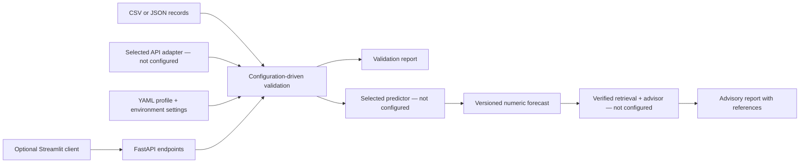

# Backend guide: extend after selecting the problem and data

## 1. Architecture



The same Python core serves the solar and general profiles. Do not duplicate it
for a new dataset. Provider schemas and model libraries belong in adapters, not
HTTP routes. Training belongs in offline scripts, not normal app startup.

## 2. Configuration

`config/project.yaml` is an **example solar schema**, not a confirmed dataset
contract. Weather fields are optional until the source and model are selected.
Any field marked `required: true` must exist in every applicable input row.

| Setting | Meaning |
|---|---|
| `schema_version` | Change when the input/target contract changes |
| `target_column` | Candidate numeric target; required for historical mode, forbidden in inference |
| `timestamp_column` | Required aware datetime for one time series; `null` for tabular data |
| `expected_interval_minutes` | Optional cadence check; `null` means cadence is not finalized |
| `column_mapping` | Source field name → canonical internal name |
| `unknown_columns` | `reject`, or explicitly `ignore` with a warning |
| `dtype` | `number`, `string`, `datetime`, or `boolean` |
| `required` | Whether the column must be present |
| `nullable` | Whether a present value may be blank/null |
| `unit` | Documented unit; configuration does not itself convert units |
| `minimum` / `maximum` | Optional numeric bounds in the configured unit |

Example mapping, **only if the dataset actually uses these names**:

```yaml
column_mapping:
  DATE_TIME: timestamp
  AC_POWER: power_generation
```

Never include both an alias and its canonical field in a row: that is a collision.
Do not simply label kW values as MW. Convert deliberately in the source adapter,
then document the conversion and preserve the raw source.

`APP_PROFILE_PATH` selects a profile. Other environment settings control upload
bytes, record count, prediction-point count, displayed issue count, and allowed
CORS origins. They are deployment limits, not scientific horizon decisions.
YAML profiles are exposed by `/api/v1/project`: **never put secrets in them**.

## 3. Validation contract

JSON example:

```json
{
  "mode": "historical",
  "records": [
    {"timestamp": "2026-01-01T08:00:00Z", "power_generation": 10}
  ]
}
```

Send it to `POST /api/v1/data/validate`. CSV uploads use the `file` multipart field
and `?mode=historical` or `?mode=inference` query parameter.

- Validation reports return HTTP 200 with `valid: true/false`, issues, warnings,
  row count, observed columns, schema version, and optional time range.
- `row` in an issue is a **1-based data row**, excluding the CSV header.
- Unreadable/malformed CSV returns 400; oversized CSV/too many records returns 413.
- Invalid HTTP request structure or invalid forecast input returns 422.
- Each response carries `X-Request-ID`; error bodies include `request_id`.
- Validation does not save uploaded files or return their raw contents.
- UTF-8 comma-separated CSV with a unique header is supported. Other delimiters,
  Excel, JSON files, or Parquet need another loader/adapter.

Timestamps must be ISO 8601 with `Z` or an explicit UTC offset. They are normalized
to UTC. Naive timestamps are rejected; local timezone/DST policy must be decided
before adding a source-specific parser. One timestamped profile currently means
**one series**, not mixed sites/forecast runs with the same valid time.

Historical unordered/irregular timestamps produce warnings; do not train until
those are reviewed. Inference timestamps must be strictly increasing and, when a
cadence is configured, complete at that cadence. No resampling, imputation, or
unit inference happens silently. `nullable: true` merely permits missingness; it
does not implement an imputer.

Unknown fields in `ignore` mode and future target values are never forwarded to a
predictor. Numeric values must be finite and respect configured bounds. Validation
success is **not** proof of adequate history, honest forecast-time feature
availability, good data quality, legal usage, or model accuracy.

## 4. Choose and implement a data adapter

`ExternalDataProvider` in `src/project_backend/providers.py` declares:

```python
def fetch_records(self, parameters: dict[str, object]) -> list[dict[str, object]]: ...
```

The protocol's actual annotations use `Any` to support arbitrary reviewed source
fields. A concrete adapter should do all of the following:

1. Use a fixed/allowlisted provider endpoint, never a URL supplied by a public user.
2. Validate allowed parameters, time range, location access, and volume limits.
3. Read credentials from environment/secret management; never log them.
4. Set connect/read timeouts, bounded retries, and quota/error handling.
5. Preserve immutable raw responses with redacted request metadata and checksums.
6. Normalize names, units, UTC timestamps, and interval semantics.
7. Preserve provider/model identity, retrieval time, forecast issue time, valid
   time, and lead time when applicable.
8. Return records matching the active profile and keep an offline fallback.

These behaviors are **requirements for the future adapter**, not implemented
features of the current interface. Do not train against a changing live endpoint.

When selected, create an application composition module such as
`src/project_backend/configured.py` and register the real implementation:

```python
# Illustrative wiring only — SelectedProvider must be implemented first.
from project_backend.api import create_app
from project_backend.services import ServiceRegistry
from project_backend.your_provider import SelectedProvider

app = create_app(services=ServiceRegistry(provider=SelectedProvider()))
```

Run `uv run uvicorn project_backend.configured:app` from the repository root.
Without registration, `/api/v1/data/provider/validate` returns
`503 provider_not_configured` and makes no network request.

## 5. Add a predictor only after a valid baseline exists

`Predictor` in `src/project_backend/services.py` requires `model_version` and
`predict(canonical_records) -> list[float]`. The adapter owns feature engineering,
preprocessing, fitted artifact loading, feature order, and post-processing.

Before implementing it:

- Select the target and its units; distinguish average power from interval energy.
- Freeze a licensed data snapshot and chronological train/validation/test periods.
- Check whether future covariates are actually available at forecast issue time.
- Compare a simple baseline before choosing the final estimator.
- Save preprocessing and predictor together with schema/data/model versions.
- Load only trusted local artifacts; unpickling untrusted joblib/pickle is unsafe.
- Do not implement forecast lags without an explicit recent-history contract.

The scaffold does **not** receive history for lag/rolling features yet. Extend the
request schema and test feature availability before using such a model. Use a
pipeline based only on supplied future inputs until that extension is implemented.

Register a real predictor in the composition module just like the provider. Do
not add a fake predictor merely to make the forecast endpoint look successful.
Test-only predictors appear in `tests/`, not the default application.

The service preserves row order, checks output length, rejects non-finite/out-of-
bounds predictions, and attaches model/schema versions and the target unit.
It does not automatically clip or invent prediction intervals. If clipping is a
reviewed solar-specific rule, implement and document it in the model adapter.

## 6. Advisor extension

`Advisor.generate(forecast)` must return `AdvisoryReport`. Until implemented,
`POST /api/v1/advice` returns `503 advisor_not_configured`.

The report schema requires references for each recommendation and rejects unknown
reference IDs. This is **structural validation only**, not proof that evidence is
trusted or supports a claim. The selected retrieval/LangGraph adapter must:

- Calculate numerical summaries and risks deterministically.
- Retrieve from curated, licensed sources with provenance.
- Validate citations against the actual retrieved passages, not invented titles.
- Validate supplied forecast provenance/model compatibility; client JSON alone is
  not an authenticated stored forecast.
- Avoid precise storage schedules without capacity, power, charge state,
  efficiency, reserve, and load constraints.
- Return a clear no-evidence/unavailable fallback instead of fabricated advice.
- Keep all actions advisory and subject to human review.

Do not add LangGraph/vector database/LLM dependencies until retrieval and forecast
interfaces are understood. The existing lifecycle document supplies the later plan.

## 7. Before public deployment

This is a local-development foundation. Add authentication/authorization, rate
limits, provider-budget controls, request timeouts, retention policies, and a
reverse proxy/platform **body-size limit before multipart/JSON parsing**. Current
CSV byte/row checks do not replace pre-parser server limits; JSON is parsed before
the record-count check. Restrict CORS to actual UI origins. CORS is not authentication.

Do not expose filesystem paths, raw API keys, uploaded data, or full provider
responses in logs. Current application logs include request ID, method, status,
duration, and exception type, not request bodies or query values.

Deploy the API and UI as separate processes/services unless the chosen hosting
setup explicitly supports both. A hosted Streamlit shell must use a reachable
backend URL; `127.0.0.1` cannot reach a different hosted service.
